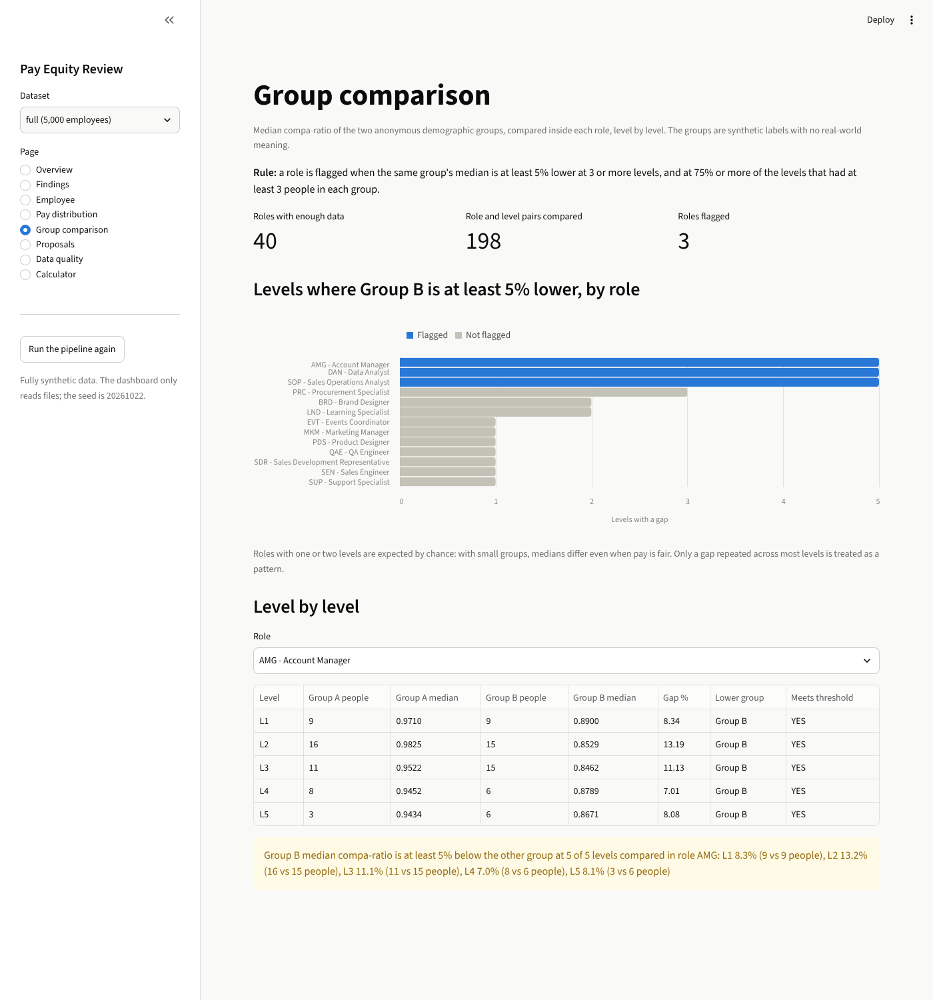

# Pay Equity Review: synthetic data generator and anomaly detector

[](https://github.com/chanduKasya/pay-equity-review/actions/workflows/test.yml)

Candidate project for the YottaFlex AI recruitment drive.

**The task:** compare compensation against role, level, location and documented
factors to identify unexplained disparities, on synthetic data that I generate.

**What this repository does:**

1. **Generates** a synthetic company: 5,000 employees, 200 role/level
   combinations, 8 locations in 5 currencies and 3 years of salary history,
   with promotions, part-time changes and currency changes. Each employee
   also has an anonymous demographic group (`Group A` or `Group B`).
2. **Runs the review workflow:** effective-dated bands, FTE and currency
   normalisation, compa-ratio and band position, comparable groups, and
   adjustment proposals with evidence and an approval trail.
3. **Injects labelled edge cases** and stores the labels in a separate
   ground truth folder.
4. **Detects** the problems using only the input tables. The detector
   estimates the pay policy from the data with a regression; it is not
   given the generator's formula. It also compares the two demographic
   groups inside each role to find systemic pay gaps.
5. **Validates and evaluates:** 106 data-quality checks, precision and recall
   against the ground truth, and a same-seed reproducibility check.

Everything is fully synthetic. No external or personal data is used.

## Quick start

Requirements: Python 3.10 or newer. Nothing to install: the project uses only
the Python standard library.

```
git clone https://github.com/chanduKasya/pay-equity-review.git
cd pay-equity-review
python3 src/run_all.py --scale starter
```

`starter` builds 500 employees in under a second. For the full 5,000:

```
python3 src/run_all.py --scale full
```

`run_all.py` runs five steps in order and stops if one fails. Each step can
also be run alone:

| Step | Command | What it does |
|---|---|---|
| 1 | `python3 src/generate.py --scale full --seed 20261022` | Builds every table as CSV, JSON and SQL |
| 2 | `python3 src/validate.py --scale full` | Runs 106 data-quality checks |
| 3 | `python3 src/detect.py --scale full` | Finds anomalies from the input tables only |
| 4 | `python3 src/evaluate.py --scale full` | Scores the findings against the ground truth |
| 5 | `python3 src/reproduce.py --scale full` | Generates twice and compares checksums |

Optional tests (32 tests, about three seconds):

```
python3 -m venv .venv
source .venv/bin/activate
pip install pytest
python -m pytest
```

The virtual environment is needed on systems where Python is managed by the
operating system or Homebrew, which refuse a plain `pip install`.

## Optional dashboard

A Streamlit app lets you explore the results in a browser: findings with
their evidence, one employee's pay history, the pay distribution, proposals
with their approval trail, the group comparison, the validation report and
a compa-ratio calculator.

```
python3 -m venv .venv
source .venv/bin/activate
pip install -r requirements-app.txt
streamlit run app.py
```

The app only reads the files in `data/`, `output/` and `ground_truth/`. The
core project in `src/` still needs nothing beyond the standard library.




## Run with Docker

If you have Docker, nothing else needs installing. The image contains
Python 3.12, the project and the dashboard's packages.

```
docker build -t pay-equity-review .
docker run --rm -p 8501:8501 pay-equity-review
```

Then open `http://localhost:8501`. To run the pipeline or the tests inside
the same image instead of the dashboard:

```
docker run --rm pay-equity-review python3 src/run_all.py --scale starter
docker run --rm pay-equity-review python3 -m pytest
```

## Continuous integration

`.github/workflows/test.yml` runs on every push and pull request, on Python
3.10, 3.12 and 3.13. Each job runs `python3 src/run_all.py --scale starter`
(generate, validate, detect, evaluate, and the checksum comparison against
the dataset saved in the repository) and then `pytest`. The badge at the top
of this page shows the latest result.

## How to verify the key behaviour

After `python3 src/run_all.py --scale full` you should see:

- `Validation (full): 106 of 106 checks passed`
- an evaluation table ending in `ALL  258  263  252  11  6  0.958  0.977  0.967`
- `Reproducibility (full): 34 of 34 files identical across two runs`

The same results are saved as files:

| File | Contents |
|---|---|
| `output/full/validation_summary.md` | Every check with pass or fail |
| `output/full/evaluation.md` | Precision, recall and F1 per issue type |
| `output/full/findings.csv` | Each finding with its evidence in plain words |
| `output/full/employee_metrics.csv` | Compa-ratio, band position, expected ratio and group median per employee |
| `output/full/reproducibility.md` | Checksums of both runs, file by file |

## Results (full dataset, seed 20261022)

### Volume

| Table | Rows | | Table | Rows |
|---|---|---|---|---|
| role | 40 | | performance_evidence | 11,791 |
| level | 5 | | promotion | 1,225 |
| location | 8 | | tenure | 5,000 |
| fx_rate | 15 | | comparable_group | 523 |
| compensation_band | 4,800 | | comparable_group_member | 6,651 |
| employee | 5,000 | | adjustment_proposal | 577 |
| salary_record | 18,690 | | proposal_event | 2,236 |
| demographics | 5,000 | | | |

4,590 employees are active and 410 have left. 610 salary records are part-time,
and 81 are paid in a different currency from their band.

### Detection against ground truth

| Issue type | Labelled | Flagged | Found | Extra | Missed | Precision | Recall |
|---|---|---|---|---|---|---|---|
| Salary compared to expired band | 40 | 40 | 40 | 0 | 0 | 1.000 | 1.000 |
| FTE ignored | 40 | 40 | 40 | 0 | 0 | 1.000 | 1.000 |
| Currency conversion missing | 30 | 30 | 30 | 0 | 0 | 1.000 | 1.000 |
| Adjustment applied without approval | 15 | 15 | 15 | 0 | 0 | 1.000 | 1.000 |
| Incomparable roles grouped without rationale | 15 | 15 | 15 | 0 | 0 | 1.000 | 1.000 |
| Unexplained outlier, low | 76 | 70 | 70 | 0 | 6 | 1.000 | 0.921 |
| Unexplained outlier, high | 39 | 50 | 39 | 11 | 0 | 0.780 | 1.000 |
| Systemic disparity (per role) | 3 | 3 | 3 | 0 | 0 | 1.000 | 1.000 |
| **All** | **258** | **263** | **252** | **11** | **6** | **0.958** | **0.977** |

How to read this honestly:

- The five rule-based edge cases score 100% because each one breaks a rule
  that can be checked exactly. This shows the labels and the data agree. It
  does not show the detector would cope with messier real-world data.
- The outlier rows are the meaningful ones. The detector is not told the
  pay policy; it estimates it from the data (see the next section). The 6
  misses are low-paid injected outliers that are too mild to cross the
  0.08 threshold.
- All 11 extra "high" flags are the same kind of person: their rating fell
  sharply in 2026, and the no-pay-cut rule kept their salary above what
  their current rating predicts. They were not injected, so they count as
  false positives, but a reviewer would probably want to see them.
- `output/full/outlier_threshold_sweep.csv` shows the trade-off. A threshold
  of 0.07 gives 0.974 recall at 0.848 precision. A threshold of 0.10 gives
  0.971 precision at 0.870 recall.

### Pay policy estimated by the detector

`src/policy_fit.py` fits a least-squares regression of compa-ratio on years
in level, rating and documented premium, using only the standard library.
The tenure cap is found by trying 2 to 10 years and keeping the best fit.
The line is fitted twice: the second time without the people furthest from
it, so that real outliers do not pull the estimate towards themselves.

| Parameter | Estimated by the detector | Used by the generator |
|---|---|---|
| Ratio with no tenure and a rating of 3 | 0.8918 | 0.9000 |
| Added per year in level | 0.0187 | 0.0200 |
| Years after which tenure stops counting | 6 | 5 |
| Added per rating point | 0.0278 | 0.0300 |
| Added per unit of documented premium | 1.0184 | 1.0000 |

The right-hand column is never read by the detector. `evaluate.py` prints
it only to check the estimate. The small differences have a cause: pay was
last set at the April review, but tenure is measured at the December review
date, so everyone looks about eight months more senior than when their pay
was fixed. With 500 employees the estimate is noisier (cap 4, 0.0295 per
year), and one mild outlier is missed.

### Validation

106 of 106 checks pass. They cover primary keys (15), foreign keys (26),
allowed values (12), ID formats (10), date ordering (7), arithmetic
reconciliation (7), lifecycle transitions (3), duplicates (18), ground-truth
separation (3), coverage (3) and exports (2).

The tests also damage a copy of the data on purpose (a broken foreign key, a
duplicate key, a wrong ratio, an illegal status jump) and confirm the validator
fails each time. A validator that always passes proves nothing.

### Reproducibility

Two runs with the same seed give 34 of 34 identical files (SHA-256). A run
with a different seed changes 23 files. The 11 that stay the same are the
fixed master tables and the SQL schema.

## The five required edge cases

| Edge case | How it appears in the data | How it is detected |
|---|---|---|
| Salary compared to expired band | The salary record points at last year's band | The band's dates do not cover the salary's effective date |
| FTE ignored | The recorded compa-ratio was computed on part-time pay | Recomputing with pay divided by FTE gives a different value |
| Currency conversion missing | Pay in one currency was divided by a midpoint in another | Recomputing with conversion gives a different value |
| Adjustment applied without approval | A proposal jumps from HR_REVIEWED to APPLIED | The adjustment's trail has no APPROVED event |
| Incomparable roles grouped without rationale | A custom group mixes job families and gives no rationale | Members span more than one family or level, and the rationale is empty |

Deliberate unexplained outliers are added as well: 2% of active employees
are paid low and 1% high against the documented policy.

## Systemic disparity across demographic groups

A pay equity review also has to ask whether one group is paid less as a
pattern, not only whether individuals are outliers. The `demographics`
table gives every employee an anonymous label, `Group A` or `Group B`. The
labels are synthetic and stand for no real-world category.

| | |
|---|---|
| What is injected | In 3 of the 40 roles, Group B is paid 10% below the policy at every level (160 active employees) |
| How it is detected | Inside each role, the two groups' median compa-ratios are compared level by level. A role is flagged as `SYSTEMIC_DISPARITY` when the same group is at least 5% lower at 3 or more levels, and at 75% or more of the levels that had at least 3 people in each group |
| Result | All 3 affected roles found, no other role flagged |
| Report | `output/full/group_gap_by_role_level.csv` lists every role and level with both medians and the gap |

Two design points:

- **One level proves little.** With about 10 people per group, medians
  differ by 5% by chance in a few of the 198 role and level pairs. The
  first version of the rule (3 levels only) flagged a fourth role by
  chance. Requiring most levels to agree removed it. Across 8 different
  seeds the final rule found 23 of 24 affected roles and flagged no others.
- **A person is reported once.** Employees inside a flagged systemic gap are
  listed under that finding, and are not also reported as individual low
  outliers. They are also left out when the pay policy is estimated.

The 500-employee dataset has too few people per role and level to compare
groups, so nothing is injected or flagged there.

## Repository layout

```
src/                 all code (see docs/how_it_works.md for a guided tour)
app.py               optional Streamlit dashboard over the results
Dockerfile           image with the project and the dashboard
.github/workflows/   automated run of the pipeline and tests on every push
tests/               pytest tests
data/<scale>/csv     input tables, one CSV per table
data/<scale>/json    the same tables as JSON
data/<scale>/sql     schema.sql and seed.sql (SQLite-compatible)
data/<scale>/manifest.json   seed, command, row counts, checksums
ground_truth/<scale> labels, kept apart from the inputs on purpose
output/<scale>       findings, metrics, validation, evaluation, reproducibility
docs/                assumptions, data dictionary, design decisions, AI usage
prompts/             every prompt sent to an AI tool
```

## Documents

| Document | What it answers |
|---|---|
| `docs/assumptions.md` | What I assumed where the brief was unclear, and deviations |
| `docs/data_dictionary.md` | Every table, field, key, allowed value and rule |
| `docs/design_decisions.md` | Key decisions, trade-offs, testing approach and limitations |
| `docs/how_it_works.md` | A plain-language tour of the code, file by file |
| `docs/ai_usage.md` | Where AI was used, and what was reviewed and validated |
| `prompts/prompt_history.md` | Every prompt, in order |

## Known limitations

- The detector and the generator share the compa-ratio formulas, so the
  rule-based edge cases are found perfectly by construction.
- The estimated policy assumes the same shape as the real one (a straight
  line per factor with a tenure cap). Real pay data would be messier, and
  small datasets give a noisier estimate.
- The outlier check looks at current factors only, so pay protected by an
  earlier rating is flagged as unexplained.
- Only base salary is modelled. There is one review cycle.
- Exchange rates are made-up yearly values.
- Demographic groups are two anonymous synthetic labels. No real gender,
  ethnicity, age or names are generated (see D1 in the assumptions).
- The systemic check compares medians with fixed thresholds. It is not a
  statistical test, it needs enough people per role and level, and it
  does not adjust for tenure or rating inside a level.
- For employees hired before 2024, time in level is counted from hire.
- The dashboard is read-only. It shows results and does not edit data or approve proposals.

More detail is in `docs/design_decisions.md`.

## Environment

Run and checked on Python 3.10 and 3.13 on Linux and on Python 3.15 on
macOS (Apple M1). All three produce identical checksums. Data files use `\n` line endings on every
platform.
